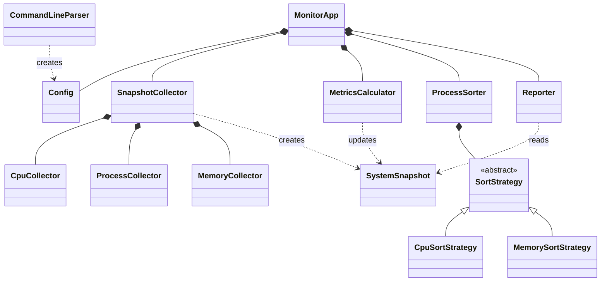

# System Observability Monitor

## Overview

This document lays out how I plan to refactor the System Observability Monitor, a Linux command-line tool that reads `/proc`, works out CPU and memory usage, and prints a refreshing report of the busiest processes. After Milestones 1 and 2 the program works, but most of its control flow is packed into `main.cpp` and a handful of free functions. The new design moves that work into classes that each do one job, so every piece can be explained and tested on its own.

## 1. Requirements

At its core, the program keeps sampling the operating system, turns raw counters into percentages, and reports what it found. Each requirement below describes behavior you can observe, so a test can check it.

| ID | Requirement |
|---|---|
| R1 | Read `MemTotal` and `MemAvailable` from `/proc/meminfo` and report total, used, and available memory in kB, where used = total − available and never exceeds total. |
| R2 | Treat only numeric `/proc` directories as processes, read each PID and name from `comm`, and skip processes that exit during the scan. |
| R3 | Calculate overall CPU % from two samples of the `cpu` line in `/proc/stat`, counting idle + iowait as idle time. Report it as unavailable when no time passed or the counters are inconsistent. |
| R4 | Calculate each process's CPU % from `utime + stime` across two samples using the actual elapsed time. Match samples by PID and start time, so new and reused PIDs are reported as unavailable. |
| R5 | Report each process's resident memory (`VmRSS`) in kB. A process with no `VmRSS` stays in the list with memory reported as unavailable, not zero. |
| R6 | Take a baseline sample, then print a new report every configured interval until stopped, or after a configured number of reports. |
| R7 | Sort processes by CPU or memory in descending order, with unavailable values last and ties broken by smaller PID, then show the first N rows. Sorting must not change the full process list kept for the next sample. |
| R8 | Accept `--interval`, `--top`, `--sort`, `--count`, and `--help` options and reject invalid values with a clear error message. |
| R9 | Print a summary (CPU %, memory, processes collected, rows shown, sort mode, interval) and a table of PID, name, CPU %, and RSS (kB), showing `--` for unavailable values. |
| R10 | Report an error and exit with code 1, rather than crashing, when a required system file cannot be read. |

Here's an example command and the kind of report it should print. The numbers are just for illustration.

<table>
<tr><th>Example command</th><th>Expected report</th></tr>
<tr><td><pre>./build/system_observability_monitor \
    --sort cpu --top 3 --interval 1000</pre></td>
<td><pre>CPU: 50.2%   Memory (kB): total=8222320 used=571556 available=7650764
Processes collected: 68 | Showing: 3 | Sort: CPU | Interval: 1000 ms
&nbsp;
    PID  NAME                CPU%    RSS (kB)
   2989  sh                  98.7        1852
      1  process_api          0.0        5820
      2  kthreadd             0.0          --</pre></td></tr>
</table>

## 2. System Design

The new design is built around one class that manages everything, `MonitorApp`, plus four helpers that each handle one stage of a refresh: `SnapshotCollector` reads the system, `MetricsCalculator` works out the percentages, `ProcessSorter` picks which rows to show, and `Reporter` formats them. Before any of that starts, `CommandLineParser` turns the program arguments into a `Config`. The data types and `/proc` readers from Milestones 1 and 2 stay exactly as they are underneath. Right now `main()` parses arguments, runs the loop, sorts, and prints all by itself. Splitting that up means each class has one job I can explain and test separately.

### 2.1 Class Structure and Relationships



*Figure 1. Proposed classes and their relationships. A filled diamond marks ownership (composition), a hollow triangle marks inheritance, and a dashed arrow marks a class that creates or uses another.*

Most of the design is composition. `MonitorApp` owns its collector, calculator, sorter, reporter, and settings, and `SnapshotCollector` owns the three `/proc` readers, so every object has exactly one owner and gets destroyed along with it. That means there's no raw `new` or `delete` anywhere. I only use inheritance where there really are interchangeable versions of the same behavior: `CpuSortStrategy` and `MemorySortStrategy` both implement `SortStrategy`, and `ProcessSorter` talks to them through the base class. `SystemSnapshot` holds a `MemoryInfo`, a `CpuCounters`, and a vector of `ProcessInfo` records. It's a plain value type: `SnapshotCollector` creates it, `MetricsCalculator` fills in the rest, and `Reporter` reads it.

### 2.2 Responsibilities and Main Interfaces

`SnapshotCollector` builds one complete, timestamped `SystemSnapshot`. It gets the time, then has `CpuCollector`, `ProcessCollector`, and `MemoryCollector` read `/proc/stat`, the per-process folders, and `/proc/meminfo`. The collectors only read raw values and don't do any percentage math. The `/proc` location is passed into the constructor, so a test can point the collector at a small fake `/proc` folder instead of the real system.

```cpp
class SnapshotCollector {
public:
    explicit SnapshotCollector(const std::filesystem::path& procRoot = "/proc");
    SystemSnapshot collect() const;   // CPU % fields are left empty

private:
    CpuCollector m_cpu;
    ProcessCollector m_processes;
    MemoryCollector m_memory;
};
```

`MetricsCalculator` is the one place CPU percentages get calculated. Given the previous and current snapshots, it works out overall CPU % from the change in the `/proc/stat` counters, and each process's CPU % from the change in its CPU ticks divided by the real elapsed time. It matches processes by PID and start time, so a process without a valid earlier sample just keeps an empty value. Throughout the design, an empty `std::optional` means "unavailable", which keeps it separate from a real zero (R3–R5). The clock tick rate is passed into the constructor, so tests can use a fixed number.

```cpp
class MetricsCalculator {
public:
    explicit MetricsCalculator(long ticksPerSecond);   // throws if <= 0
    void apply(const SystemSnapshot& previous, SystemSnapshot& current) const;
    static std::optional<double> overallCpu(const CpuCounters& a, const CpuCounters& b);

private:
    long m_ticksPerSecond;
};
```

`ProcessSorter` picks the rows to display. It sorts a copy of the process list with its `SortStrategy` and keeps the first N rows. Since it takes the list by `const` reference and returns a new vector, it physically can't change the full list that `MonitorApp` needs for the next CPU calculation. The current code doesn't implement this yet.

```cpp
class ProcessSorter {
public:
    explicit ProcessSorter(std::unique_ptr<SortStrategy> strategy);
    std::vector<ProcessInfo> selectRows(const std::vector<ProcessInfo>& processes,
                                        std::size_t topN) const;
    std::string label() const;   // e.g. "CPU", shown in the report

private:
    std::unique_ptr<SortStrategy> m_strategy;
};
```

`CommandLineParser` turns the program arguments into a `Config` and throws `std::invalid_argument` with a readable message if something's wrong. `Reporter` formats a finished snapshot and its display rows into any `std::ostream`. It never reads `/proc` or calculates anything, so a test can capture its output in a string. `MonitorApp` ties it all together: it decides the order things happen in, but it doesn't do any collecting, calculating, sorting, or formatting itself.

```cpp
struct Config {
    std::chrono::milliseconds interval{1000};
    std::size_t topN = 10;
    std::string sortName = "cpu";
    long long count = 0;   // 0 = run until Ctrl+C
    bool showHelp = false;
};

class MonitorApp {
public:
    MonitorApp(Config config, SnapshotCollector collector, std::ostream& out);
    void run();   // baseline, then repeated reports

private:
    Config m_config;
    SnapshotCollector m_collector;
    MetricsCalculator m_calculator;
    ProcessSorter m_sorter;
    Reporter m_reporter;
};
```

After the refactor, all `main()` does is parse the options, build a `MonitorApp`, call `run()`, and turn any exception into an error message and exit code 1 (R10).

### 2.3 Interaction for One Refresh Cycle


*Figure 2. Processing sequence for one refresh cycle, coordinated by MonitorApp.*

Before the loop starts, `MonitorApp` calls `SnapshotCollector::collect()` once to get a baseline, since CPU percentages need two samples. Each cycle then waits for the interval and collects a fresh snapshot that only has raw counters in it. `MonitorApp` hands the previous and current snapshots to `MetricsCalculator::apply()`, which fills in the overall and per-process CPU values using the actual time between the two timestamps. Next, `ProcessSorter::selectRows()` returns a sorted copy with at most N processes, and `Reporter::print()` writes out the summary and table. Last, `MonitorApp` holds on to the full current snapshot (not the trimmed display copy) as the baseline for the next round. A process that just started has nothing to match in the baseline, so it shows `--` until the next cycle. Put together, these steps are how the classes cover R1–R9.

### 2.4 Refactoring from the Current Code

The refactor mostly moves existing logic into new homes instead of rewriting it, so the program should behave and print exactly the same as in Milestone 2.

| Current code | Refactored design |
|---|---|
| `collect_snapshot()` | `SnapshotCollector::collect()` |
| `calculate_overall_cpu()`, `calculate_metrics()` | `MetricsCalculator::overallCpu()`, `MetricsCalculator::apply()` |
| `SortKey`, `compareByCpu()`, `compareByMemory()`, `sort_and_limit()` | `SortStrategy` subclasses and `ProcessSorter` |
| `Options`, `parseArgs()`, `printUsage()` in `main.cpp` | `Config` and `CommandLineParser` |
| Loop and setup in `main()` | `MonitorApp::run()` |
| Collectors, data types, `Reporter` | Kept; `Reporter` receives the sort label from `ProcessSorter` |

## 3. Test Design

I based the tests on the requirements and the public interfaces above. Component tests each focus on one class, like parsing `/proc` text or calculating a percentage, and an integration test checks that the classes work together. A separate `monitor_tests` executable runs each test function, reports every failed check through a small `check(condition, message)` helper, and returns a non-zero exit code if anything fails.

```cpp
int g_failures = 0;

void check(bool condition, const std::string& message) {
    if (!condition) {
        std::cerr << "FAIL: " << message << '\n';
        ++g_failures;
    }
}

void testMemorySummary() {   // T1
    std::istringstream in("MemTotal: 16000000 kB\nMemAvailable: 6000000 kB\n");
    const MemoryInfo m = MemoryCollector::parse(in);
    check(m.used_kb == 10000000, "T1: used = total - available");
}

int main() {
    testMemorySummary();
    // ... one function per test case ...
    return g_failures == 0 ? 0 : 1;   // non-zero tells ctest the suite failed
}
```

Tests that expect an error wrap the call in `try`/`catch` and check that the right exception type was thrown. For now, each test just lists its setup and what should happen; the actual results will be recorded once the tests are written in the final milestone.

Several tests run against small fake `/proc` folders kept in `tests/fixtures/`. `proc_basic/` has `stat`, `meminfo`, process folders `1/` and `42/`, plus non-process entries `self/`, `sys/`, `net/`, and a plain file named `123`. `proc_kthread/` has a process with no `VmRSS` line, and `proc_vanished/` has a process folder with no `comm` file.

### 3.1 Planned Test Cases

| Test | Target / setup | Expected result |
|---|---|---|
| T1 — Memory summary (R1) | Parse `MemTotal: 16000000 kB` and `MemAvailable: 6000000 kB` with `MemoryCollector::parse()`. | total = 16000000, available = 6000000, used = 10000000. |
| T2 — Memory edge cases (R1, R10) | Parse text missing `MemAvailable`; then parse MemTotal 100 with MemAvailable 150. | The first throws `std::runtime_error`; the second caps available at 100 and gives used = 0. |
| T3 — Process enumeration (R2) | Run `ProcessCollector::collect()` on `proc_basic/`. | Exactly PIDs 1 and 42 are returned with names from `comm`; `self`, `sys`, `net`, and `123` are not. |
| T4 — Vanished process (R2) | Run `ProcessCollector::collect()` on `proc_vanished/`. | The process with no `comm` is skipped, no exception is thrown, and the other processes are returned. |
| T5 — Stat parsing (R4) | Parse `123 (my (weird) app) S 1 1 1 0 -1 4194304 10 0 0 0 25 17 0 0 20 0 1 0 9999` with `readProcessCpu()`; then parse the truncated line `5 (x) S 1 2`. | The first gives `cpu_ticks` = 42 and `start_ticks` = 9999; the second returns false. |
| T6 — Resident memory (R5) | Collect a process whose `status` has `VmRSS: 2048 kB`, then the process in `proc_kthread/`. | The first has `memory_kb` = 2048; the second is still listed with `memory_kb` empty. |
| T7 — Overall CPU (R3) | `overallCpu()` with sample A (user 200, idle 800) and sample B (user 250, idle 850). | 50.0, because 100 ticks passed and 50 of them were idle. |
| T8 — Invalid CPU samples (R3) | `overallCpu()` with identical samples; with idle + iowait falling from 850 to 800; and with idle growing by 200 while the total grows by 100. | An empty result in all three cases; no unsigned subtraction wraps around. |
| T9 — Process CPU (R4) | `apply()` with 100 ticks per second, snapshots 2.0 s apart, and one process whose ticks rise from 100 to 300, then from 100 to 500. | `cpu_usage` = 100.0, then 200.0 (values above 100% are allowed for multithreaded processes). |
| T10 — Unmatched processes (R4) | `apply()` with a PID that is only in the current snapshot; a PID whose start time changed; and two snapshots with the same timestamp. | `cpu_usage` stays empty in every case, and nothing is divided by zero. |
| T11 — Sort order (R7) | Sort CPU values {PID 5: 5.0, PID 3: 5.0, PID 9: empty, PID 7: 90.0}; then memory values {PID 2: 100, PID 4: empty, PID 6: 500, PID 1: 100}. | CPU order is 7, 3, 5, 9; memory order is 6, 1, 2, 4. |
| T12 — Top-N selection (R7) | `selectRows()` with 5 processes and N = 2, then 3 processes and N = 10. | 2 rows, then 3 rows; the input list keeps all of its processes in their original order. |
| T13 — Valid options (R8) | Parse no arguments; `-i 2000 -n 5 -s memory -c 3`; and `--help`. | Defaults (1000 ms, 10, cpu, 0); the given values; `showHelp` = true. |
| T14 — Invalid options (R8) | Parse each of `-i 0`, `-n abc`, `-c -1`, `-i` with no value, `--bogus`, and `--sort size`. | Each throws `std::invalid_argument` with a message naming the problem. |
| T15 — Report formatting (R9) | Print a snapshot with 5 processes, CPU 18.44%, and 2 display rows into a `std::ostringstream`; then print one with all CPU and memory values empty and a 30-character process name. | The first shows `CPU: 18.4%` and `Processes collected: 5 \| Showing: 2`; the second shows `--` instead of `0` and cuts the name to 15 characters. |
| T16 — Missing system files (R10) | Construct `SnapshotCollector` on a folder that does not exist, then on a fixture whose `stat` does not begin with `cpu`. | `collect()` throws in both cases, which `main()` reports with exit code 1. |
| T17 — End-to-end (R1–R9) | Run `MonitorApp` on `proc_basic/` with a 10 ms interval and a count of 2, writing to a `std::ostringstream`. | The baseline message is printed, followed by exactly 2 complete reports. |

T7–T10 are deterministic: I build the snapshots by hand with exact counters and timestamps, so the results don't depend on the real clock or on whatever happens to be running. T17 runs `MonitorApp`, `SnapshotCollector`, `MetricsCalculator`, `ProcessSorter`, and `Reporter` together on fixed fixture data, so the whole workflow gives the same result every time.

On top of that, three manual checks on a live system repeat the Milestone 2 acceptance criteria. Running a busy loop like `sh -c 'while :; do :; done'` should push overall CPU up and show the loop near 100%, then drop once it's stopped. A listed process's RSS should match `VmRSS` in `/proc/<pid>/status`, give or take small changes between reads. And three reports at `--interval 1000` versus `--interval 2000` should take about 3 s and 6 s.

Every test uses controlled input with a known answer and compares the result against that answer, instead of just checking that the program runs. That also means a failure points at its cause. For example, if T9 passes but T17 shows `--` for every process, the bug is in how `MonitorApp` keeps the baseline snapshot, not in the CPU math.

### 3.2 Coverage and Evaluation Plan

| Requirement | Supporting tests | Evidence to record in final milestone |
|---|---|---|
| R1 — Memory summary | T1, T2, T17 | Parsed totals and the capped edge case. |
| R2 — Process enumeration | T3, T4, T17 | Only numeric PIDs listed; vanished process skipped. |
| R3 — Overall CPU % | T7, T8, manual | Known percentage; invalid samples reported as unavailable. |
| R4 — Per-process CPU % | T5, T9, T10, manual | Correct ticks and percentages; unmatched processes unavailable. |
| R5 — Resident memory | T6, manual | VmRSS value read; missing value kept as unavailable. |
| R6 — Continuous monitoring | T17, manual | Exact number of reports; interval visibly changes refresh time. |
| R7 — Sorting and top N | T11, T12 | Expected order and row count; input list unchanged. |
| R8 — Command-line options | T13, T14 | Parsed settings; error message for each invalid input. |
| R9 — Report output | T15, T17 | Captured output matching the expected text. |
| R10 — Error handling | T2, T16 | Exception raised and exit code 1 returned. |

In the final report, I'll add the actual result and a pass/fail status for each test, and explain any that fail.

## Optional Bonus — Design Pattern

I'm using the Strategy pattern for sorting. In the current code, the sort mode is scattered across three places: a `SortKey` enum, an `if/else` in `sort_and_limit()` that picks a comparison function, and a separate expression in `main()` that picks the label shown in the report. Adding a new sort mode, like by PID or by name, means editing all three and keeping them in sync by hand. Missing one can cause the report to claim a different sort order than the one it actually used.

With Strategy, each sort order is its own class that implements `SortStrategy`, and each class provides both its comparison and its label, so the two can't drift apart. `ProcessSorter` plays the context role: it owns one strategy and hands it to `std::sort` without caring which order it is. A small creation function, `makeSortStrategy()`, is the only place a `--sort` name gets matched to a class.

```cpp
class SortStrategy {
public:
    virtual bool compare(const ProcessInfo& a, const ProcessInfo& b) const = 0;
    virtual std::string label() const = 0;
    virtual ~SortStrategy() = default;
};

class CpuSortStrategy : public SortStrategy { /* highest CPU first, "CPU" */ };
class MemorySortStrategy : public SortStrategy { /* highest RSS first, "Memory" */ };

std::unique_ptr<SortStrategy> makeSortStrategy(const std::string& name);

std::vector<ProcessInfo> ProcessSorter::selectRows(const std::vector<ProcessInfo>& processes,
                                                   std::size_t topN) const {
    std::vector<ProcessInfo> rows = processes;   // copy: input is never changed
    std::sort(rows.begin(), rows.end(),
              [this](const ProcessInfo& a, const ProcessInfo& b) { return m_strategy->compare(a, b); });
    if (rows.size() > topN) rows.resize(topN);
    return rows;
}
```

Compared with the basic design, adding a sort order now takes one new class and one line in `makeSortStrategy()`, and nothing in `ProcessSorter`, `Reporter`, `MonitorApp`, or `main()` has to change. Each strategy can also be tested on its own (T11).
